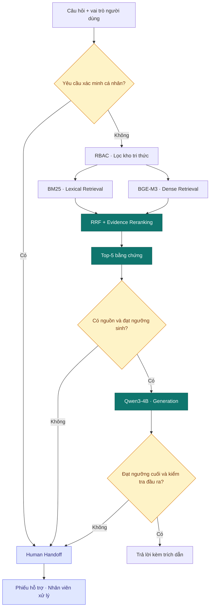

<div align="center">

# EH-RAG

### Evidence-aware Hybrid Retrieval-Augmented Generation

**Trợ lý chăm sóc khách hàng dựa trên tri thức doanh nghiệp**  
_Truy xuất kết hợp · Đánh giá bằng chứng · Phối hợp AI – Nhân viên_


[Giới thiệu](#overview) · [Kiến trúc](#architecture) · [Cài đặt](#installation) · [Thực nghiệm](#benchmark) · [Kết quả](#results)

</div>

---

> Đây là đồ án học phần sử dụng dữ liệu doanh nghiệp **giả lập**. Tên An Phát, chính sách, quy trình và các thông tin liên hệ trong kho tri thức không đại diện cho một doanh nghiệp thực. Hệ thống được thiết kế để chạy nội bộ, không phải sản phẩm đã được kiểm định cho môi trường production.

<a id="overview"></a>

## 01 · Giới thiệu

EH-RAG là kiến trúc Retrieval-Augmented Generation (RAG) hướng tới bài toán chăm sóc khách hàng bằng tiếng Việt. Thay vì chỉ sinh câu trả lời, hệ thống tìm kiếm nguồn tri thức được cấp quyền, đánh giá mức độ phù hợp của bằng chứng và quyết định liệu yêu cầu có thể được xử lý tự động hay cần chuyển tiếp cho nhân viên.

Ba trọng tâm của đề tài:

- **Hybrid Retrieval:** kết hợp truy xuất từ khóa BM25 với truy xuất ngữ nghĩa BGE-M3.
- **Evidence-aware Processing:** sử dụng Evidence Score trong xếp hạng tài liệu và kiểm soát quá trình xử lý.
- **Human Handoff:** phối hợp AI với nhân viên khi thông tin không đủ căn cứ hoặc yêu cầu cần xác minh.

### Chức năng chính

| Nhóm chức năng        | Mô tả                                                                       |
| :-------------------- | :-------------------------------------------------------------------------- |
| Hỏi đáp có căn cứ     | Sinh câu trả lời tiếng Việt với nguồn trích dẫn từ kho tri thức.            |
| Quản lý tài liệu      | Thêm, cập nhật, xóa tài liệu và lập chỉ mục embedding.                      |
| Kiểm soát truy cập    | Lọc nguồn theo vai trò trước khi truy xuất.                                 |
| Chuyển tiếp nhân viên | Tạo và xử lý phiếu hỗ trợ, theo dõi trạng thái.                             |
| Quản trị              | Quản lý tài khoản, phân quyền và trạng thái tài khoản.                      |
| Theo dõi dịch vụ      | Lịch sử hội thoại, phản hồi và KPI nghiệp vụ.                               |
| Đánh giá nghiên cứu   | Benchmark Retrieval-only, End-to-End, Ablation Study và kiểm định theo cặp. |

<a id="architecture"></a>

## 02 · Kiến trúc EH-RAG

### 2.1. Luồng xử lý



_Sơ đồ giản lược luồng hỏi đáp nghiệp vụ; các nhánh chào hỏi, lỗi dịch vụ và quy tắc phụ không được biểu diễn đầy đủ._

### 2.2. Evidence Score và Evidence Reranking

Với truy vấn $q$ và đoạn tài liệu $d$, điểm bằng chứng kết hợp được xác định như sau:

$$
E(q,d)=0.55C(q,d)+0.45S(q,d)
$$

Trong đó:

- $C(q,d)$: độ bao phủ từ khóa có trọng số IDF.
- $S(q,d)$: điểm ngữ nghĩa được chuẩn hóa từ cosine similarity của embedding BGE-M3.

Hai danh sách xếp hạng được hợp nhất bằng Reciprocal Rank Fusion:

$$
RRF(q,d)=\frac{1}{50+r_B(d)}+\frac{1}{50+r_D(d)}
$$

Các hạng tương ứng là $r_B$ và $r_D$; một nhánh không có hạng hợp lệ không đóng góp vào tổng.

Điểm xếp hạng cuối cùng của EH-RAG:

$$
F(q,d)=RRF(q,d)+0.03E(q,d)
$$

### 2.3. Evidence Gate

Gọi $E_{max}$ là điểm bằng chứng lớn nhất trong các kết quả Top-5.

| Điều kiện mặc định     | Hành vi                                                              |
| :--------------------- | :------------------------------------------------------------------- |
| $E_{max}<0.24$         | Bỏ qua generation và chuyển tiếp nhân viên.                          |
| $0.24\le E_{max}<0.38$ | Có thể thực hiện generation nhưng vẫn chuyển tiếp theo ngưỡng cuối.  |
| $E_{max}\ge0.38$       | Có thể trả lời nếu đáp ứng các kiểm tra đầu ra và quy tắc nghiệp vụ. |

Evidence Score là điểm liên quan theo heuristic, **không phải xác suất câu trả lời chính xác**. Các ngưỡng trên là cấu hình của nghiên cứu, chưa được chứng minh tối ưu.

### 2.4. Kiến trúc triển khai

```text
Browser · http://localhost:8501
    │
    ▼
Streamlit app · Docker
    ├── Authentication / RBAC
    ├── EH-RAG pipeline
    ├── Conversation / Ticket / KPI
    ├── SQLite · app_data volume
    └── Ollama · http://ollama:11434
          ├── qwen3:4b  → Generation
          └── bge-m3    → Embedding
              ollama_models volume
```

Streamlit chỉ được công bố tại `127.0.0.1:8501`. Ollama giao tiếp qua mạng Docker nội bộ, không mở cổng ra máy chủ. Phiên bản này không yêu cầu API key dịch vụ LLM, Cloudflare Tunnel hay FastAPI Gateway.

## 03 · Công nghệ

| Thành phần     | Công nghệ                      |
| :------------- | :----------------------------- |
| Ngôn ngữ       | Python 3.11                    |
| Giao diện      | Streamlit                      |
| LLM runtime    | Ollama                         |
| Mô hình sinh   | Qwen3-4B (`qwen3:4b`)          |
| Embedding      | BGE-M3 (`bge-m3`, 1.024 chiều) |
| Retrieval      | BM25, cosine similarity, RRF   |
| Cơ sở dữ liệu  | SQLite                         |
| Xử lý tài liệu | pypdf, python-docx             |
| Triển khai     | Docker, Docker Compose         |
| Kiểm thử       | pytest, benchmark V200         |
| Biểu đồ        | Matplotlib (tùy chọn)          |

<a id="installation"></a>

## 04 · Cài đặt và khởi chạy

### 4.1. Yêu cầu môi trường

- Windows 10/11 với Docker Desktop (WSL2), hoặc Linux/macOS với Docker và Compose v2.
- RAM hệ thống khuyến nghị từ 16 GB; cần đủ RAM khả dụng cho Docker và mô hình. GPU NVIDIA hỗ trợ CUDA là tùy chọn.
- Dung lượng đĩa trống tham khảo từ 12 GB trở lên; thực tế phụ thuộc image, model, cache và dữ liệu.
- Internet để tải image và model lần đầu. Sau khi tải đầy đủ, quá trình suy luận chạy nội bộ.
- Python 3.11 trên máy host nếu muốn chấm lại, tổng hợp hoặc vẽ biểu đồ ngoài Docker.

### 4.2. Tải mã nguồn

```powershell
git clone https://github.com/TienManh-Manilife/RAG-AI.git
cd RAG-AI
```

Hoặc tải ZIP mã nguồn và mở terminal tại thư mục chứa `docker-compose.yml`.

### 4.3. Cấu hình tài khoản quản trị

Trên Windows PowerShell:

```powershell
.\scripts\setup.ps1
```

Script tạo `.env` nếu chưa tồn tại và sinh mật khẩu admin ngẫu nhiên. Lưu mật khẩu ở nơi an toàn; email mặc định là `admin@anphat.local`.

Nếu không dùng PowerShell, sao chép `.env.example` thành `.env`, sau đó điền mật khẩu mạnh (ít nhất 12 ký tự, không giữ giá trị mẫu) vào `BOOTSTRAP_ADMIN_PASSWORD`.

| Biến môi trường            | Mục đích                                |
| :------------------------- | :-------------------------------------- |
| `BOOTSTRAP_ADMIN_NAME`     | Tên quản trị viên ban đầu               |
| `BOOTSTRAP_ADMIN_EMAIL`    | Email quản trị viên ban đầu             |
| `BOOTSTRAP_ADMIN_PASSWORD` | Mật khẩu khởi tạo (bí mật)              |
| `RAG_MIN_RELEVANCE`        | Ngưỡng định tuyến cuối, mặc định `0.38` |

> [!CAUTION]
> Không commit `.env`, mật khẩu, bản sao cơ sở dữ liệu hay dữ liệu cá nhân lên Git. Thay đổi mật khẩu bootstrap không tự đổi mật khẩu tài khoản đã tồn tại trong SQLite.

### 4.4. Khởi động Docker

```powershell
docker compose up -d --build
docker compose logs -f pull-models app
```

Docker tự tải hai model Ollama và ứng dụng tự khởi tạo kho tri thức, tạo embedding. Lần đầu có thể mất nhiều thời gian tùy tốc độ mạng và phần cứng.

Sau khi ứng dụng sẵn sàng, truy cập **[http://localhost:8501](http://localhost:8501)**. Đăng nhập admin bằng thông tin được tạo ở bước trước, hoặc đăng ký tài khoản khách hàng từ giao diện.

### 4.5. Chạy bằng GPU NVIDIA (tùy chọn)

Nếu máy đã hỗ trợ GPU passthrough trong Docker:

```powershell
docker compose -f docker-compose.yml -f compose.gpu.yml up -d --build
docker compose exec ollama ollama ps
```

Không sử dụng override GPU trên máy không hỗ trợ. Cột `PROCESSOR` trong `ollama ps` cho biết mô hình đang chạy bằng CPU/GPU khi model đã được nạp.

### 4.6. Tái sử dụng model đã tải

Nếu cả hai model đã tồn tại trong volume và image ứng dụng đã được build, có thể khởi động lại mà không chạy dịch vụ tải model:

```powershell
docker compose up -d --no-deps --pull never ollama
docker compose exec ollama ollama list
```

Chỉ khi xác nhận có đủ `qwen3:4b` và `bge-m3`:

```powershell
docker compose up -d --no-deps --pull never --no-build app
```

Nếu dùng GPU, thêm `-f docker-compose.yml -f compose.gpu.yml` trước `up` cho cả hai lệnh. Không đổi tên project/volume tùy tiện nếu muốn tiếp tục sử dụng dữ liệu cũ.

<a id="usage"></a>

## 05 · Sử dụng hệ thống

### 5.1. Vai trò

| Vai trò                 | Quyền và nghiệp vụ                                                                              |
| :---------------------- | :---------------------------------------------------------------------------------------------- |
| Khách hàng (`user`)     | Đăng ký, hỏi đáp nguồn công khai, lịch sử của mình, phản hồi, theo dõi và mở lại phiếu.         |
| Nhân viên (`staff`)     | Tra cứu nội bộ, quản lý tài liệu, embedding, tiếp nhận và xử lý phiếu, xem KPI và kiểm thử RAG. |
| Quản trị viên (`admin`) | Quyền nghiệp vụ của nhân viên, tạo tài khoản staff, khóa/mở tài khoản khác.                     |

### 5.2. Kho tri thức

Hai tài liệu seed được khai báo trong [`knowledge_base/manifest.json`](knowledge_base/manifest.json):

| Tài liệu                                | Phạm vi truy cập                                    |
| :-------------------------------------- | :-------------------------------------------------- |
| `Chinh_sach_khach_hang_AnPhat.pdf`      | `customer` – khách hàng và vai trò có quyền cao hơn |
| `Quy_trinh_nghiep_vu_noi_bo_AnPhat.pdf` | `staff` – nhân viên và quản trị viên                |

Tài liệu seed chỉ được nạp khi khởi tạo dữ liệu. Nhân viên có thể quản lý tài liệu PDF, DOCX, TXT, MD (tối đa 15 MB mỗi file). PDF chỉ chứa ảnh cần OCR trước.

Để tạo lại embedding theo cơ chế lập chỉ mục của ứng dụng:

```powershell
docker compose exec app python -m rag_engine.cli reindex
```

Benchmark V200 yêu cầu đúng hai PDF và phạm vi truy cập chuẩn. Nếu đã chỉnh sửa kho tri thức trong giao diện, cần khôi phục corpus chuẩn trước khi thực nghiệm.

### 5.3. Phối hợp AI – Nhân viên

Khi yêu cầu cần xác minh cá nhân, thiếu căn cứ, không đạt ngưỡng hoặc kiểm tra đầu ra không thành công, hệ thống có thể chuyển yêu cầu sang quy trình phiếu hỗ trợ. Nhân viên tiếp nhận, xác minh, trả lời và hoàn thành phiếu. Khách hàng theo dõi và có thể mở lại phiếu đã hoàn thành.

<a id="benchmark"></a>

## 06 · Thực nghiệm Benchmark V200

### 6.1. Thiết lập

| Thông số                | Giá trị |
| :---------------------- | ------: |
| Tổng câu hỏi tiếng Việt |     200 |
| Có căn cứ trả lời       |     160 |
| Cần chuyển tiếp         |      40 |
| Câu hỏi khách hàng      |     118 |
| Câu hỏi nhân viên       |      82 |
| Cấu hình Retrieval-only |       4 |
| Cấu hình End-to-End     |       5 |
| Tổng lượt xử lý         |   1.800 |

Dữ liệu: [`benchmark/questions_200.csv`](benchmark/questions_200.csv) và [`benchmark/questions_200.jsonl`](benchmark/questions_200.jsonl). Các phương pháp sử dụng chung tập câu hỏi, kho tri thức, Top-5, mô hình sinh và bộ chấm.

### 6.2. Phương pháp so sánh

| Method CLI        | Phương pháp                              | Phân loại           | Retrieval-only | End-to-End |
| :---------------- | :--------------------------------------- | :------------------ | :------------: | :--------: |
| `lexical`         | Lexical RAG                              | Primary Baseline    |       ✓        |     ✓      |
| `dense`           | Dense-only RAG                           | Additional Baseline |       ✓        |     ✓      |
| `standard_hybrid` | Standard Hybrid (w/o Evidence Reranking) | Ablation            |       ✓        |     ✓      |
| `hybrid`          | **EH-RAG Full (Ours)**                   | **Proposed**        |       ✓        |     ✓      |
| `no_gate`         | EH-RAG w/o Evidence Gate                 | Ablation            |       —        |     ✓      |

Standard Hybrid chỉ bỏ thành phần `+0.03E` trong xếp hạng, vẫn sử dụng Evidence Gate chung. No Gate bỏ hai ngưỡng bằng chứng nhưng giữ nguyên truy xuất, RBAC và các quy tắc kiểm tra đầu ra/chuyển tiếp còn lại. Lexical dùng BM25 kết hợp lexical coverage; Dense-only dùng cosine similarity. Không cần chạy Retrieval-only riêng cho No Gate vì dùng chung retrieval với EH-RAG.

### 6.3. Kiểm tra môi trường trước benchmark

```powershell
docker compose ps
docker compose exec ollama ollama list
docker compose exec -w /app app python -m scripts.smoke_test
```

### 6.4. Chạy Retrieval-only

Chạy tuần tự tại thư mục gốc dự án:

```powershell
docker compose exec -w /app app python -m rag_engine.benchmark --dataset 200 --retrieval-only --method lexical
docker compose exec -w /app app python -m rag_engine.benchmark --dataset 200 --retrieval-only --method dense
docker compose exec -w /app app python -m rag_engine.benchmark --dataset 200 --retrieval-only --method standard_hybrid
docker compose exec -w /app app python -m rag_engine.benchmark --dataset 200 --retrieval-only --method hybrid
```

### 6.5. Chạy End-to-End

```powershell
docker compose exec -w /app app python -m rag_engine.benchmark --dataset 200 --method lexical
docker compose exec -w /app app python -m rag_engine.benchmark --dataset 200 --method dense
docker compose exec -w /app app python -m rag_engine.benchmark --dataset 200 --method standard_hybrid
docker compose exec -w /app app python -m rag_engine.benchmark --dataset 200 --method hybrid
docker compose exec -w /app app python -m rag_engine.benchmark --dataset 200 --method no_gate
```

Lệnh `hybrid` là cấu hình đề xuất EH-RAG đầy đủ. Kết quả mặc định nằm trong `results/v200/end_to_end_hybrid_all_default/`.

### 6.6. Checkpoint và tiếp tục thực nghiệm

Benchmark lưu `predictions.json` sau mỗi câu đã hoàn thành. Khi gián đoạn, chạy lại đúng lệnh, giữ nguyên cấu hình và run ID để tiếp tục phần còn thiếu. Những dự đoán đã hoàn thành nhưng sai chất lượng không được tự động chạy lại để thay đổi kết quả.

```powershell
# Chạy tối đa 10 câu mới mỗi lượt
docker compose exec -w /app app python -m rag_engine.benchmark --dataset 200 --method hybrid --max-new 10

# Tạo lần thực nghiệm độc lập
docker compose exec -w /app app python -m rag_engine.benchmark --dataset 200 --method hybrid --run-id rep2
```

Khi thay đổi dataset, corpus, model hoặc cấu hình inference, dùng run ID mới theo kiểm tra fingerprint của benchmark. Để so sánh độ trễ công bằng, giữ môi trường và cấu hình runtime nhất quán.

### 6.7. Chấm điểm, tổng hợp và vẽ biểu đồ

Các lệnh sau chạy trên máy host, không cần Ollama, với dữ liệu dự đoán gốc còn đầy đủ:

```powershell
python -m rag_engine.benchmark_score results/v200
python scripts/parse_metrics.py results/v200
python -m rag_engine.benchmark_compare results/v200
```

Nếu đã có `scripts/plot_results.py` từ bản bổ sung biểu đồ:

```powershell
python -m pip install matplotlib
python scripts/plot_results.py results/v200
```

Cấu trúc đầu ra (khi lưu đầy đủ):

```text
results/v200/
├── end_to_end_hybrid_all_default/
│   ├── predictions.json        # Dự đoán + nhãn, checkpoint
│   ├── predictions.csv         # Bản xuất dữ liệu dự đoán
│   ├── scores.json             # Điểm chi tiết và tổng hợp
│   └── scores.csv
├── ...                         # Các cấu hình còn lại
├── metrics_summary.csv
├── paired_comparison.csv
├── evidence_threshold_diagnostic.csv
└── figures/default/            # Biểu đồ (nếu chạy plot)
```

Không sửa checkpoint bằng tay. Chấm lại không gọi LLM, nhưng cần dữ liệu dự đoán gốc. Hãy lưu cả raw predictions, scores, CSV tổng hợp và figures để có thể kiểm toán, tái chấm và phân tích lỗi.

### 6.8. Thước đo

| Nhóm          | Chỉ số                                                                                             |
| :------------ | :------------------------------------------------------------------------------------------------- |
| Retrieval     | Recall@1, Recall@3, Recall@5, MRR@5 (160 câu có căn cứ)                                            |
| Generation    | Answerable Completion, Citation Rate, Keyphrase Coverage, Keyphrase Full Match, Checklist Accuracy |
| Human Handoff | Precision, Recall, F1, Accuracy, False Handoff Rate, False Answer Rate                             |
| Tổng thể      | Overall Pass (200 câu), nhóm lỗi, truy xuất trái quyền                                             |
| Hiệu năng     | Mean, Median, P95 Latency                                                                          |
| Thống kê      | Exact McNemar Test theo cặp                                                                        |

Checklist và Overall Pass là thước đo tự động theo quy ước benchmark, không thay thế đánh giá ngữ nghĩa bởi chuyên gia.

<a id="results"></a>

## 07 · Kết quả nghiên cứu

<div align="center">

| Recall@5 | Handoff Recall | Handoff F1 | Overall Pass |
| :------: | :------------: | :--------: | :----------: |
| **100%** |    **100%**    | **88,89%** |  **81,50%**  |

_EH-RAG Full · End-to-End · V200_

</div>

### 7.1. Retrieval-only

| Phương pháp       |      R@1 ↑ |      R@3 ↑ |    R@5 ↑ |    MRR@5 ↑ | Mean (s) ↓ |
| :---------------- | ---------: | ---------: | -------: | ---------: | ---------: |
| Lexical           |     81,25% |     95,00% |   96,88% |     0,8763 |  **0,004** |
| Dense-only        |     76,25% |     90,00% |   93,75% |     0,8363 |      0,067 |
| Standard Hybrid   |     85,00% |     97,50% | **100%** |     0,9122 |      0,056 |
| **EH-RAG (Ours)** | **88,75%** | **99,38%** | **100%** | **0,9370** |      0,053 |

### 7.2. End-to-End

| Phương pháp       |      R@1 ↑ |    R@5 ↑ |    MRR@5 ↑ | Handoff F1 ↑ | Checklist ↑ | Overall Pass ↑ | Mean (s) ↓ |
| :---------------- | ---------: | -------: | ---------: | -----------: | ----------: | -------------: | ---------: |
| Lexical           |     81,25% |   96,88% |     0,8763 |       71,84% |      62,50% |         68,50% |  **2,026** |
| Dense-only        |     76,25% |   94,38% |     0,8375 |       81,63% |      71,88% |         77,50% |     10,199 |
| Standard Hybrid   |     85,00% | **100%** |     0,9122 |       87,91% |  **77,50%** |     **82,00%** |     11,346 |
| **EH-RAG (Ours)** | **88,75%** | **100%** | **0,9370** |       88,89% |      76,88% |         81,50% |     12,735 |
| w/o Gate          | **88,75%** | **100%** | **0,9370** |   **89,89%** |  **77,50%** |     **82,00%** |     12,440 |

_Số in đậm là kết quả tốt nhất quan sát được theo từng cột, không biểu thị ý nghĩa thống kê._

### 7.3. So sánh định tuyến

| Phương pháp       |  TP |  FP |  FN |  TN | Accuracy ↑ |
| :---------------- | --: | --: | --: | --: | ---------: |
| Lexical           |  37 |  26 |   3 | 134 |     85,50% |
| Dense-only        |  40 |  18 |   0 | 142 |     91,00% |
| Standard Hybrid   |  40 |  11 |   0 | 149 |     94,50% |
| **EH-RAG (Ours)** |  40 |  10 |   0 | 150 |     95,00% |
| w/o Gate          |  40 |   9 |   0 | 151 | **95,50%** |

Lớp dương là câu hỏi cần chuyển tiếp. TP là chuyển tiếp đúng; FP là chuyển tiếp nhầm; FN là bỏ sót chuyển tiếp; TN là định tuyến đúng nhánh tự động.

### 7.4. Nhận định

- So với Lexical, EH-RAG tăng Recall@1 **7,50 điểm phần trăm**, tăng Overall Pass **13 điểm phần trăm** (137 → 163 câu đạt), giảm chuyển tiếp nhầm từ 26 xuống 10 (**61,54%**).
- EH-RAG có 0/40 trường hợp bỏ sót chuyển tiếp trong tập thử; tất cả cấu hình ghi nhận 0 lượt truy xuất trái quyền. Đây không phải bảo đảm an toàn tuyệt đối trên dữ liệu thực tế.
- Kiểm định McNemar cho Overall Pass giữa EH-RAG và Lexical đạt `p ≈ 6.16e-6` (kiểm định riêng lẻ, chưa hiệu chỉnh đa so sánh).
- Evidence Reranking cải thiện Recall@1 và MRR@5 so với Standard Hybrid, nhưng khác biệt Recall@1 chưa có ý nghĩa thống kê ở mức 5%. Hai biến thể Ablation đạt Overall Pass cao hơn EH-RAG 0,50 điểm phần trăm (`p = 1`); chưa chứng minh được lợi ích độc lập của Evidence Gate.
- Độ trễ trung bình của EH-RAG cao hơn Lexical; P95 của EH-RAG là 14,536 s, trong khi w/o Gate là 31,224 s. Không thể quy toàn bộ chênh lệch latency cho riêng thuật toán nếu chưa đo riêng runtime và từng giai đoạn.

Nguồn số liệu: `metrics_summary.csv` và `paired_comparison.csv` của thực nghiệm V200. Các chỉ số được làm tròn để trình bày. Hiện nhóm còn lưu bảng tổng hợp, kết quả theo cặp và biểu đồ; dữ liệu dự đoán chi tiết của lượt chạy này không còn đầy đủ, nên không thể chấm lại độc lập nếu chưa khôi phục hoặc chạy lại.

## 08 · Cấu trúc mã nguồn

```text
RAG-AI/
├── app.py                         # Giao diện Streamlit
├── rag_engine/
│   ├── auth.py                    # Xác thực, phân quyền
│   ├── config.py                  # Cấu hình hệ thống
│   ├── documents.py               # Quản lý tài liệu, embedding
│   ├── retrieval.py               # Hybrid Retrieval + Reranking
│   ├── generation.py              # Sinh và kiểm tra câu trả lời
│   ├── handoff.py                 # Quy tắc chuyển tiếp
│   ├── pipeline.py                # Quy trình hỏi đáp
│   ├── service.py                 # Hội thoại, phiếu, KPI
│   ├── ollama.py                  # Kết nối Ollama
│   ├── cli.py                     # Bootstrap, reindex
│   ├── benchmark.py               # Entry point benchmark
│   ├── benchmark_run.py           # Thực thi và resume
│   ├── benchmark_checkpoint.py    # Lưu checkpoint
│   ├── benchmark_inference.py     # Sinh dự đoán
│   ├── benchmark_score.py         # Chấm độc lập
│   └── benchmark_compare.py       # So sánh theo cặp
├── knowledge_base/                # Hai PDF + manifest
├── benchmark/                     # Dataset và hướng dẫn benchmark
├── scripts/                       # Setup, backup, smoke test, parse
├── tests/                         # Unit tests
├── results/                       # Kết quả sinh ra khi chạy
├── Dockerfile
├── docker-compose.yml
├── compose.gpu.yml
├── requirements.txt
├── .env.example
└── README.md
```

Cây thư mục rút gọn, không liệt kê toàn bộ file phụ. `scripts/plot_results.py` thuộc bản bổ sung biểu đồ.

## 09 · Kiểm thử, vận hành và sao lưu

```powershell
# Unit tests (không cần chạy suy luận Ollama thực)
docker compose exec -w /app app python -m pytest -q tests

# Trạng thái và log
docker compose ps
docker compose logs --tail 100 app
docker compose logs --tail 100 ollama

# Theo dõi tài nguyên
docker stats

# Build lại sau khi cập nhật code
docker compose up -d --build

# Dừng, giữ dữ liệu
docker compose down
```

Dữ liệu SQLite và mô hình được giữ trong named volumes `app_data` và `ollama_models`. Thư mục `./results` được bind mount vào `/app/data/reports`.

Sao lưu dữ liệu ứng dụng bằng `scripts/backup.ps1` (PowerShell). Script tạm dừng app, đóng gói volume rồi khởi động lại; cần kiểm tra đúng volume nếu máy có nhiều project tương tự. Sao lưu riêng `results/` vì là bind mount, không thuộc bản sao volume ứng dụng.

> [!WARNING]
> Không chạy `docker compose down -v` nếu cần giữ tài khoản, hội thoại, kho tri thức và model đã tải. Tùy chọn `-v` xóa các named volume của Compose.

### Xử lý lỗi thường gặp

| Hiện tượng                      | Kiểm tra / khắc phục                                                                                    |
| :------------------------------ | :------------------------------------------------------------------------------------------------------ |
| Không mở được `localhost:8501`  | Kiểm tra `docker compose ps` và log `app`; chờ hoàn thành bootstrap.                                    |
| `pull-models` thất bại          | Kiểm tra Internet, DNS, dung lượng và log `pull-models`.                                                |
| Ollama offline                  | Kiểm tra trạng thái container và danh sách model.                                                       |
| Docker thiếu RAM                | Kiểm tra `docker stats`, log, giới hạn WSL2 và trạng thái OOM; giảm tải đồng thời, dùng GPU nếu hỗ trợ. |
| Benchmark báo corpus không khớp | Khôi phục đúng hai PDF chuẩn và scope, kiểm tra lại embedding.                                          |
| Benchmark bị gián đoạn          | Chạy lại đúng lệnh với cùng run ID; giữ `predictions.json`.                                             |
| Quên mật khẩu admin             | Sử dụng quy trình quản trị/khôi phục phù hợp; không xóa volume chỉ để đặt lại mật khẩu.                 |

## 10 · Giới hạn và hướng phát triển

Hệ thống là bản nghiên cứu local-only; không có MFA, xác minh email hay HTTPS đầu cuối. Kho tri thức gồm hai tài liệu giả lập, chưa đại diện cho dữ liệu doanh nghiệp đa dạng. Bộ chấm dựa trên nguồn và cụm từ không phản ánh đầy đủ tính đúng đắn ngữ nghĩa. Kiểm tra trích dẫn và chuyển tiếp không loại bỏ hoàn toàn hallucination. Kết quả latency phụ thuộc phần cứng và runtime, không phải SLA.

Hướng phát triển: hiệu chỉnh Evidence Score và ngưỡng trên validation độc lập; xác minh bằng chứng cấp mệnh đề; tối ưu thời gian nạp mô hình và cache; đánh giá bởi chuyên gia; mở rộng corpus và kiểm thử bảo mật trước khi triển khai thực tế.

<a id="team"></a>

## 11 · Tài liệu tham khảo

- [Retrieval-Augmented Generation (Lewis et al., 2020)](https://arxiv.org/abs/2005.11401)
- [BGE-M3 (Chen et al., 2024)](https://arxiv.org/abs/2402.03216)
- [Qwen3 Technical Report](https://arxiv.org/abs/2505.09388)
- [Ollama – Qwen3](https://ollama.com/library/qwen3)
- [Ollama – BGE-M3](https://ollama.com/library/bge-m3)
- [Ollama – Embeddings API](https://docs.ollama.com/api/embed)
- [Streamlit Documentation](https://docs.streamlit.io/)
- [Docker Compose Documentation](https://docs.docker.com/compose/)

---

<div align="center">

</div>
