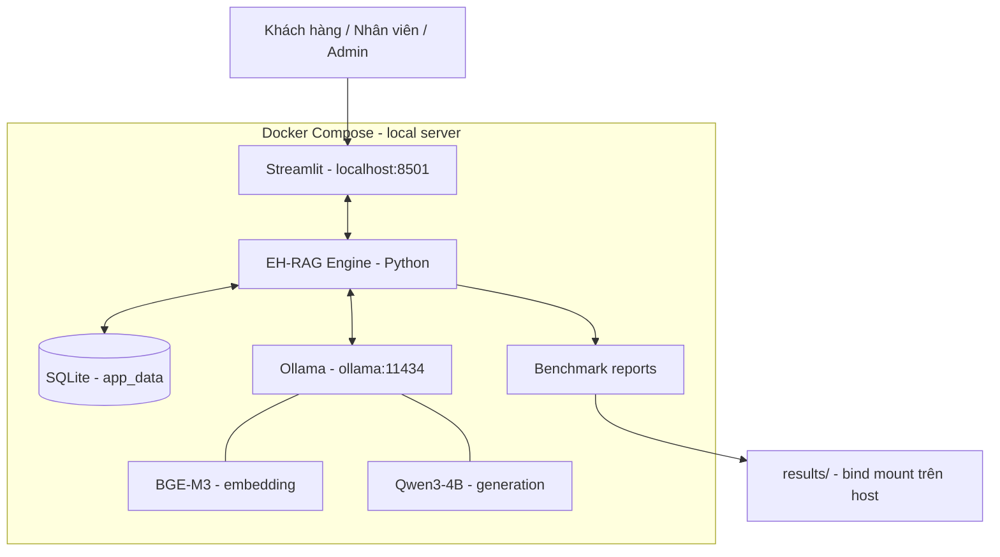
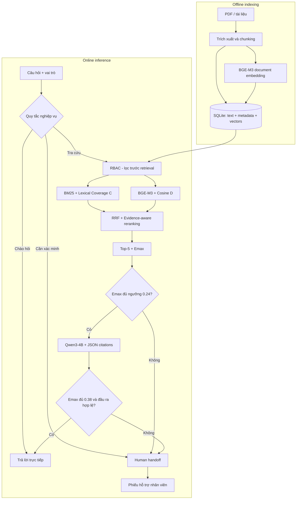

# RAG-AI | EH-RAG

**Evidence-aware Hybrid Retrieval-Augmented Generation for Human–AI Collaborative Customer Service**


> **Đồ án nghiên cứu — 100% dữ liệu doanh nghiệp giả lập.** Tên An Phát, chính sách, email `.example` và dữ liệu trong `knowledge_base/` không đại diện cho doanh nghiệp thực. Không sử dụng để quyết định quyền lợi thực tế.

## Thành viên nhóm

| STT | Họ và tên |
|---:|---|
| 1 | Nguyễn Hải Phong |
| 2 | Trần Anh Dũng |
| 3 | Nguyễn Tiến Mạnh |

## Mục lục

- [1. Tổng quan và đóng góp](#1-tổng-quan-và-đóng-góp)
- [2. Kiến trúc triển khai](#2-kiến-trúc-triển-khai)
- [3. Kiến trúc EH-RAG đề xuất](#3-kiến-trúc-eh-rag-đề-xuất)
- [4. Phương pháp đối chứng](#4-phương-pháp-đối-chứng)
- [5. Yêu cầu và cài đặt](#5-yêu-cầu-và-cài-đặt)
- [6. Vai trò và kho tri thức](#6-vai-trò-và-kho-tri-thức)
- [7. Kiểm thử và tái lập](#7-kiểm-thử-và-tái-lập)
- [8. Phương pháp đánh giá](#8-phương-pháp-đánh-giá)
- [9. Kết quả thực nghiệm](#9-kết-quả-thực-nghiệm)
- [10. Phân tích và thảo luận](#10-phân-tích-và-thảo-luận)
- [11. Vận hành và bảo trì](#11-vận-hành-và-bảo-trì)
- [12. Cấu trúc mã nguồn](#12-cấu-trúc-mã-nguồn)
- [13. Giới hạn và hướng phát triển](#13-giới-hạn-và-hướng-phát-triển)
- [14. Tài liệu tham khảo](#14-tài-liệu-tham-khảo)

## 1. Tổng quan và đóng góp

RAG-AI là hệ thống trợ lý chăm sóc khách hàng chạy cục bộ, sử dụng RAG để truy xuất chính sách doanh nghiệp trước khi sinh câu trả lời. Khác với việc chỉ yêu cầu LLM trả lời, hệ thống còn kiểm soát quyền tài liệu, kiểm tra đầu ra và chuyển tiếp nhân viên khi chưa đủ căn cứ hoặc cần xác minh nghiệp vụ.

**RAG truyền thống** gồm ba khâu: truy xuất ngữ cảnh liên quan từ kho tri thức, đưa ngữ cảnh vào prompt và sinh câu trả lời bằng LLM. Truy xuất đúng không bảo đảm câu trả lời đúng; tài liệu đứng đầu cũng chưa chắc chứa đủ căn cứ. EH-RAG giải quyết các vấn đề này bằng cách dùng một điểm bằng chứng thống nhất trong xếp hạng và định tuyến.

Các đóng góp trong phạm vi đồ án:

1. **Evidence-aware Hybrid Retrieval:** kết hợp BM25 và BGE-M3, hợp nhất thứ hạng bằng RRF và bổ sung Hybrid Evidence Score để xếp hạng lại.
2. **Evidence-aware Decision Routing:** tái sử dụng điểm bằng chứng trong generation gate và quyết định AI trả lời hay chuyển tiếp nhân viên, kết hợp kiểm tra nguồn và quy tắc nghiệp vụ.
3. **Kiến trúc tích hợp EH-RAG:** RBAC trước truy xuất, generation có trích dẫn, quản lý kho tri thức và quy trình phiếu hỗ trợ người–máy.
4. **Benchmark tái lập:** đánh giá retrieval, generation, handoff và latency trên 50 câu có nhãn; checkpoint/resume giúp chạy nhiều phiên mà không bỏ qua câu trả lời sai.

**Kết quả nổi bật (End-to-End, 50 câu):**

| Recall@1 | MRR@5 | Handoff F1 | Handoff Accuracy | Mean Latency |
|---:|---:|---:|---:|---:|
| **95,00%** | **0,9750** | **95,24%** | **98,00%** | **2,390 s** |

BM25, BGE-M3, RRF và Qwen3 là kỹ thuật/mô hình có sẵn. Đóng góp của nhóm là phương án tích hợp và các cơ chế heuristic được thiết kế cho bài toán; chưa chứng minh tính mới tuyệt đối so với tất cả nghiên cứu trước.

## 2. Kiến trúc triển khai



| Thành phần | Công nghệ / chức năng |
|---|---|
| Giao diện | Streamlit: xác thực, chat, kho tài liệu, phiếu, KPI |
| RAG Engine | Python: RBAC, retrieval, fusion, generation, handoff |
| Knowledge base | SQLite: văn bản, metadata, embedding, tài khoản và nghiệp vụ |
| Model serving | Ollama: `qwen3:4b`, `bge-m3` |
| Triển khai | Docker Compose, WSL2 trên Windows, GPU NVIDIA tùy chọn |
| Lưu trữ | Named volumes `app_data`, `ollama_models`; bind mount `results/` cho báo cáo |

Không sử dụng Cloudflare, FastAPI Gateway hay gateway API key trong phiên bản local này. Streamlit chỉ publish tại `127.0.0.1:8501`; Ollama giao tiếp qua mạng Docker, không publish cổng ra host theo cấu hình gốc. Không xem đây là cấu hình production công khai Internet.

## 3. Kiến trúc EH-RAG đề xuất

### 3.1. Luồng tổng thể



Lỗi dịch vụ AI trong luồng chat cũng dẫn đến handoff; benchmark phân biệt lỗi hạ tầng với lỗi chất lượng và không commit ca lỗi hệ thống.

### 3.2. Offline indexing và RBAC

- Trích xuất nội dung PDF theo trang bằng `pypdf`. Với đoạn PDF dài, giữ nguyên đoạn tối đa 1.500 ký tự; chia theo bước 1.100 ký tự và lấy thêm tối đa 130 ký tự phía trước; bỏ đoạn dưới 30 ký tự (theo nhánh xử lý PDF trong mã nguồn).
- Lưu nội dung, trang, mục, ID tài liệu/chunk, phạm vi `customer`/`staff`, embedding và tên mô hình. BGE-M3 tạo dense vector 1.024 chiều, được tính trước cho tài liệu.
- Với vai trò $a$, chỉ xét tập tài liệu được cấp quyền $\mathcal D_a=\{d\in\mathcal D\mid allow(a,d)=1\}$. Lọc quyền trước cả BM25 và cosine. Nhân viên/admin có quyền tài liệu nội bộ; khách chỉ tra cứu nguồn customer.

### 3.3. BM25 — Sparse Retrieval

BM25 xếp hạng theo từ khóa, tần suất, độ hiếm và độ dài văn bản. Mã nguồn tính trên tiêu đề, mục và nội dung chunk sau chuẩn hóa tiếng Việt (casefold, bỏ dấu, chuẩn hóa `đ`, token chữ–số, lọc/ánh xạ theo danh sách thủ công).

$$
B(q,d)=\sum_{t\in T_q} \operatorname{IDF}(t)\frac{f(t,d)(k_1+1)}{f(t,d)+k_1(1-b+b|d|/\overline L)}
$$

$$
\operatorname{IDF}(t)=\ln\left(1+\frac{N-n(t)+0.5}{n(t)+0.5}\right)
$$

Trong đó $T_q$ là tập token truy vấn duy nhất, $f$ là tần suất token, $N$ là số chunk được phép truy xuất, $n(t)$ là số chunk chứa token, $\overline L$ là độ dài trung bình (mã nguồn chặn mẫu số tối thiểu bằng 1). Cấu hình $k_1=1.2$, $b=0.75$.

### 3.4. BGE-M3 — Dense Retrieval

BGE-M3 là mô hình embedding đa ngôn ngữ hỗ trợ dense, sparse và multi-vector; dự án chỉ dùng nhánh dense. Vector truy vấn được tính online, vector tài liệu lấy từ SQLite. Điểm cosine âm được chặn về 0:

$$
D(q,d)=\max\left(0,\frac{\mathbf v_q\cdot\mathbf v_d}{\|\mathbf v_q\|\|\mathbf v_d\|}\right)
$$

BM25 hỗ trợ từ khóa chính xác; BGE-M3 bổ sung tín hiệu ngữ nghĩa, ví dụ “lấy lại tiền” và “hoàn tiền”. Hai nhánh xếp hạng độc lập trên tập chunk được cấp quyền. Giữ ứng viên nếu BM25 dương hoặc cosine ít nhất 0,45.

### 3.5. Evidence-aware Fusion và Reranking

**Lexical Coverage** là độ bao phủ token truy vấn có trọng số IDF (không phải điểm BM25 đã chuẩn hóa):

$$
C(q,d)=\frac{\sum_{t\in T_q}\operatorname{IDF}(t)\mathbf 1[t\in d]}{\sum_{t\in T_q}\operatorname{IDF}(t)}
$$

Nếu không có token truy vấn hợp lệ, coverage bằng 0. **Semantic Score** chuẩn hóa cosine:

$$S(q,d)=\operatorname{clip}\left(\frac{D(q,d)-0.30}{0.43},0,1\right)$$

**Hybrid Evidence Score:**

$$E(q,d)=0.55C(q,d)+0.45S(q,d)$$

**Reciprocal Rank Fusion** với thứ hạng $r_B,r_D$ bắt đầu từ 1:

$$RRF(d)=\frac{1}{50+r_B(d)}+\frac{1}{50+r_D(d)}$$

**Điểm xếp hạng cuối:**

$$\boxed{F(q,d)=RRF(d)+0.03E(q,d)}$$

Sắp xếp giảm dần theo $F$, giữ Top-5, lấy $E_{\max}$ là evidence lớn nhất trong Top-5 (bằng 0 nếu không có hit). Mã nguồn làm tròn evidence lưu trong hit đến 4 chữ số, còn điểm xếp hạng sử dụng giá trị chưa làm tròn.

> Evidence Score là chỉ số liên quan heuristic, **không phải xác suất câu trả lời đúng**. Trọng số 0,55/0,45 và hệ số 0,03 chưa được chứng minh tối ưu trên validation độc lập.

### 3.6. Generation gate, validation và human handoff

| Khoảng evidence lớn nhất | Hành động |
|---|---|
| Dưới 0,24 | Bỏ qua LLM; chuyển tiếp |
| Từ 0,24 đến dưới 0,38 | Gọi LLM, nhưng vẫn chuyển tiếp theo ngưỡng mặc định cuối |
| Từ 0,38 trở lên | Gọi LLM; chỉ trả lời nếu các điều kiện khác hợp lệ |

Qwen3-4B nhận system prompt, tối đa 4 mục lịch sử gần nhất (250 ký tự/mục), Top-5 chunk (1.600 ký tự/chunk) và câu hỏi. Cấu hình yêu cầu: temperature 0,05; context 8.192 token; tối đa 900 token sinh; `think=false`.

Định dạng đầu ra minh họa:

```json
{
  "status": "answered",
  "answer": "Nội dung trả lời dựa trên tài liệu được cung cấp.",
  "citations": [1]
}
```

Kiểm tra JSON, `status`, câu trả lời không rỗng, dấu hiệu thiếu căn cứ và chỉ số nguồn hợp lệ. Nguồn hiển thị được dựng lại từ metadata truy xuất. Nếu cần xác minh cá nhân/giao dịch, không có nguồn, evidence dưới ngưỡng, LLM báo thiếu căn cứ, trích dẫn/đầu ra không hợp lệ hoặc dịch vụ lỗi, hệ thống chuyển nhân viên. Citation validation chưa xác minh đầy đủ từng mệnh đề của câu trả lời.

### 3.7. Ví dụ tính điểm (minh họa, không phải benchmark)

Với $C=0.60$, cosine $D=0.65$, hạng BM25 = 2, hạng dense = 1:

| Bước | Giá trị |
|---|---:|
| Semantic Score | 0,8140 |
| Hybrid Evidence Score | 0,6963 |
| RRF | 0,03884 |
| Final Score | 0,05973 |

Nếu đây là evidence lớn nhất trong Top-5, hệ thống vượt hai ngưỡng nhưng vẫn phải kiểm tra đầu ra trước khi trả lời.

## 4. Phương pháp đối chứng

| Thành phần | Lexical Baseline | EH-RAG (Ours) |
|---|---|---|
| Sparse | BM25 | BM25 |
| Dense | Tắt | BGE-M3 + cosine |
| Evidence | $E=C$ | $E=0.55C+0.45S$ |
| Ranking | $1/(50+r_B)+0.03C$ | $RRF+0.03E$ |
| Top-K / RBAC | 5 / Có | 5 / Có |
| Generation | Qwen3-4B | Qwen3-4B |
| Gate / Handoff | 0,24 / 0,38; cùng logic | 0,24 / 0,38; cùng logic |

Lexical là cấu hình đối chứng của cùng hệ thống, **không phải BM25 thuần hay một kiến trúc độc lập hoàn toàn**. So sánh hiện tại gần với ablation nhánh dense và hybrid fusion. Dense-only, Standard Hybrid (BM25 + dense + RRF, không evidence reranking) và các ablation tách riêng chưa có kết quả thực nghiệm trong bộ dữ liệu này.

## 5. Yêu cầu và cài đặt

- Windows 10/11 + Docker Desktop (WSL2), hoặc Linux/macOS có Docker Engine + Docker Compose v2.
- Internet **lúc cài lần đầu** để tải Docker images và hai mô hình Ollama; sau khi mô hình đã tải, suy luận diễn ra nội bộ.
- Khuyến nghị tối thiểu 8 GB RAM còn trống cho trải nghiệm CPU; 16 GB trở lên thuận lợi hơn. Model Qwen3 4B chạy CPU có thể chậm; không đảm bảo thời gian đáp ứng cố định.
- Dung lượng đĩa phụ thuộc image, model, Docker cache, WSL swap và dữ liệu. Nên dự phòng ít nhất 20–30 GB trên ổ chứa Docker/model và giữ đủ dung lượng trống trên ổ hệ thống; đây là khuyến nghị vận hành, không phải ngưỡng bảo đảm.

### 5.1. Cài đặt trên PowerShell

Giải nén dự án. Mở PowerShell tại thư mục chứa `docker-compose.yml`:

```powershell
# Tạo tài khoản admin ban đầu bằng mật khẩu ngẫu nhiên, không sửa trong mã nguồn
.\scripts\setup.ps1

# Khởi động cả Streamlit và Ollama (tự kéo 2 model lần đầu)
docker compose up -d --build

# Xem quá trình tải mô hình và lập chỉ mục
docker compose logs -f pull-models app
```

Script `setup.ps1` tạo `.env` một lần, in mật khẩu admin để chủ máy lưu lại. Email mặc định là `admin@anphat.local`. **Không chia sẻ file `.env` hoặc mật khẩu.** Nếu đã có `.env`, script không ghi đè.

Mở **http://localhost:8501**. Đăng nhập admin bằng email và mật khẩu vừa tạo. Vào **Quản trị** để tạo tài khoản nhân viên. Khách hàng tự đăng ký tại màn hình đăng nhập.

Nếu không muốn dùng script trên Windows, hãy copy `.env.example` thành `.env` và **thay** `BOOTSTRAP_ADMIN_PASSWORD` bằng mật khẩu ngẫu nhiên dài ít nhất 12 ký tự, không bắt đầu bằng `REPLACE_`, `CHANGE_`, `YOUR_`.

### 5.2. GPU NVIDIA (tùy chọn)

Nếu Docker Desktop/WSL2 đã hỗ trợ NVIDIA Container Toolkit:

```powershell
docker compose -f docker-compose.yml -f compose.gpu.yml up -d --build
```

Không dùng file GPU nếu máy không có GPU NVIDIA được hỗ trợ.

## 6. Vai trò và kho tri thức

### 6.1. Vai trò và nghiệp vụ

| Vai trò       | Phạm vi                                                                                                                                                               |
| ------------- | --------------------------------------------------------------------------------------------------------------------------------------------------------------------- |
| Khách hàng    | Tự đăng ký/đăng nhập, chat nguồn được duyệt, xem lịch sử của mình, phản hồi hữu ích, theo dõi và mở lại phiếu đã hoàn thành, đổi mật khẩu                             |
| Nhân viên     | Tất cả nghiệp vụ tra cứu nội bộ, **upload/cập nhật/xóa tài liệu**, phân quyền nguồn customer/staff, tạo embedding, nhận và xử lý phiếu, phản hồi, xem KPI và đánh giá |
| Quản trị viên | Nghiệp vụ nhân viên, tạo tài khoản staff, khóa/mở tài khoản khác                                                                                                      |

Cơ chế bắt buộc trên tầng dữ liệu: các thao tác truy xuất/tài liệu của khách bị giới hạn theo vai trò; khách không được đọc chunk `staff`; truy vấn được lọc _trước_ bước truy xuất. Khách không đọc hội thoại hoặc phiếu của người khác.

**Chuyển tiếp người–máy:** khi phát hiện yêu cầu xác minh giao dịch cá nhân, không tìm được nguồn, điểm liên quan thấp, mô hình xác nhận thiếu căn cứ, thiếu trích dẫn hoặc dịch vụ AI lỗi, hệ thống **tự mở phiếu**. Nhân viên nhận phiếu → xác minh → trả lời → đóng. Khách theo dõi và có thể mở lại phiếu.

### 6.2. Kho tri thức

`knowledge_base/manifest.json` của Benchmark PDF v2 mô tả hai tài liệu seed giả lập:

| Tệp | Phạm vi |
|---|---|
| `Chinh_sach_khach_hang_AnPhat.pdf` | `customer` |
| `Quy_trinh_nghiep_vu_noi_bo_AnPhat.pdf` | `staff` |

Bộ benchmark hiện tại sử dụng hai PDF này, thay cho bộ 16 tài liệu demo cũ. Nếu tái lập từ cơ sở dữ liệu cũ đã seed, cập nhật kho tài liệu đúng phiên bản hoặc dùng môi trường kiểm thử riêng; sao lưu trước khi thay đổi dữ liệu.

Tài liệu seed chỉ được nạp **một lần** khi cơ sở dữ liệu được tạo. Sau đó nhân viên có thể xóa, cập nhật và thêm tài liệu; việc xóa không bị seed đè trở lại vào mỗi lần reload. Tải lên hỗ trợ PDF/DOCX/TXT/MD tối đa 15 MB. PDF scan phải OCR trước.

Cập nhật embedding thủ công: vào `Kho tài liệu` → `Cập nhật tất cả embedding còn thiếu`, hoặc chạy:

```powershell
docker compose exec app python -m rag_engine.cli reindex
```

Khi Docker chạy lần đầu, `app` tự bootstrap kho và lập chỉ mục BGE-M3 trước khi mở giao diện. Nếu GPU yếu/CPU chậm, startup có thể lâu; xem `docker compose logs -f app`.

## 7. Kiểm thử và tái lập

### 7.1. Thiết lập thực nghiệm

- `benchmark/questions_50.csv` và `benchmark/questions_50.jsonl`: 50 câu gắn nhãn, 38 khách hàng và 12 nhân viên.
- 40 câu có căn cứ (30 customer, 10 staff); 10 câu cần handoff (8 customer, 2 staff).
- Hai PDF giả lập An Phát; ground truth gồm nguồn/trang, điều khoản, cụm từ bắt buộc và nhãn handoff.
- Môi trường đã chạy: Windows + Docker/WSL2, RTX 4050 Laptop 6 GB VRAM, RAM 15,25 GB; Qwen3-4B và BGE-M3 qua Ollama.
- Cùng 50 ID, hash tập câu hỏi/mã nguồn benchmark và ngưỡng handoff 0,38. Fingerprint corpus khác do cấu hình hybrid bao gồm embedding; không có snapshot SQLite riêng để xác nhận tuyệt đối mọi chunk giống nhau.

### 7.2. Lưu kết quả trực tiếp ra host

Tại thư mục gốc dự án, tạo thư mục:

```powershell
New-Item -ItemType Directory -Force .\results
```

Kiểm tra service `app` trong `docker-compose.yml` có hai mount sau (chỉ thêm dòng còn thiếu, giữ cấu hình khác):

```yaml
    volumes:
      - app_data:/app/data
      - ./results:/app/data/reports
```

Thêm `results/` vào `.gitignore` và `.dockerignore` nếu chưa có. Khi dự án ở `D:\Projects\RAG-AI`, mount này ghi trực tiếp xuống `D:\Projects\RAG-AI\results`. Sau khi thay đổi, build lại app:

```powershell
docker compose up -d --build --no-deps app
docker compose exec app python -c "from pathlib import Path; Path('/app/data/reports/mount_check.txt').write_text('ok')"
Get-Content .\results\mount_check.txt
```

Kết quả `ok` xác nhận bind mount. Nếu dùng GPU overlay, dùng nhất quán `docker compose -f docker-compose.yml -f compose.gpu.yml` thay cho `docker compose`. Dữ liệu reports cũ trong named volume không tự di chuyển ra bind mount mới.

### 7.3. Lệnh benchmark

```powershell
# Smoke test
docker compose exec -w /app app python -m scripts.smoke_test

# End-to-End EH-RAG: tối đa 10 câu mới/lần
docker compose exec -w /app app python -m rag_engine.benchmark --max-new 10

# End-to-End Lexical Baseline
docker compose exec -w /app app python -m rag_engine.benchmark --lexical-only --max-new 10

# Retrieval-only EH-RAG
docker compose exec -w /app app python -m rag_engine.benchmark --retrieval-only

# Retrieval-only Lexical
docker compose exec -w /app app python -m rag_engine.benchmark --retrieval-only --lexical-only
```

Lặp lại từng lệnh cho tới `Completed: 50/50 | complete`; bỏ `--max-new 10` để chạy mọi câu còn lại. Dùng `--role user` hoặc `--role staff` nếu muốn lọc vai trò; `--run-id rep2` tạo thực nghiệm độc lập. Không thay dữ liệu, model, mã nguồn hoặc tham số giữa các lượt resume. Hybrid benchmark yêu cầu embedding đúng phiên bản, không âm thầm fallback sang lexical. Giao diện nhân viên **Kiểm thử RAG** vẫn có luồng kiểm thử cũ; cơ chế resume này dành cho CLI.

### 7.4. Checkpoint / Resume

Mỗi cấu hình có `checkpoint.txt` (JSON UTF-8) ghi nguyên tử sau từng ca hoàn thành, gồm ID, prediction, nhãn, trích dẫn, điểm evidence, latency và lỗi chất lượng. Câu trả lời sai vẫn được lưu để tránh thiên lệch; câu lỗi hệ thống không đánh dấu hoàn thành. Benchmark dừng khi bắt được system error; chạy lại sau khi khôi phục Ollama/Docker. Nếu bị ngắt đột ngột, câu chưa commit sẽ được chạy lại. Không chỉnh checkpoint bằng tay.

```text
results/
├── end_to_end_hybrid_all_default/
│   ├── checkpoint.txt
│   ├── benchmark_latest.json
│   └── benchmark_latest.csv
├── end_to_end_lexical_all_default/
├── retrieval_only_hybrid_all_default/
├── retrieval_only_lexical_all_default/  # tạo khi chạy cấu hình này
└── metrics_summary.csv
```

Báo cáo `benchmark_latest.*` trong thư mục từng cấu hình được tổng hợp cuối lượt chạy; file latest chung có thể bị ghi đè. Nếu báo cáo bị cũ do gián đoạn, chạy lại cùng lệnh để tổng hợp từ checkpoint. `complete: false` chỉ phản ánh tập đã hoàn thành, không dùng làm kết quả chính thức 50 câu.

### 7.5. Tổng hợp metrics

```powershell
# Chạy từ host, không cần Docker hoặc Ollama
python scripts/parse_metrics.py
# Tùy chọn: xem cả kết quả chưa hoàn thành
python scripts/parse_metrics.py --include-partial
```

Script xuất `results/metrics_summary.csv`, chia `all`, `user`, `staff`; tỷ lệ lưu dưới dạng 0–1. Mặc định bỏ qua báo cáo chưa hoàn thành hoặc không khớp checkpoint. Nếu dự án chưa có script, đặt bản `parse_metrics.py` của nhóm vào `scripts/` trước khi chạy.

### 7.6. Unit tests

```powershell
pip install -r requirements-dev.txt
python -m pytest -q tests
```

Hoặc trong container test tạm:

```powershell
docker compose run --rm --no-deps --user root app sh -c "pip install -r requirements-dev.txt && python -m pytest -q tests"
```

Bản Resume Patch được báo cáo 49/49 unit tests pass trong môi trường Python Linux. Đây là kết quả kiểm thử bản vá, không phải cam kết tất cả phiên bản sau đều pass; chạy lại khi thay đổi code.

## 8. Phương pháp đánh giá

### 8.1. Retrieval

Trên $N_a=40$ câu có căn cứ, gọi $r_i$ là hạng đầu tiên có nguồn/trang chuẩn, bằng vô hạn nếu không tìm thấy trong Top-5. Recall@K ở benchmark này là tỷ lệ câu có ít nhất một nguồn chuẩn trong Top-K (hit rate theo câu, không phải recall trên tập tất cả tài liệu liên quan).

$$Recall@K=\frac{1}{N_a}\sum_{i=1}^{N_a}\mathbf 1[r_i\le K],\quad MRR@5=\frac{1}{N_a}\sum_{i=1}^{N_a}\frac{\mathbf 1[r_i\le5]}{r_i}$$

### 8.2. Human Handoff

Nhãn dương là **cần chuyển nhân viên**. TP: chuyển đúng; FP: chuyển thừa; FN: bỏ sót chuyển; TN: AI tự xử lý đúng luồng (không đồng nghĩa nội dung chính xác).

$$Precision=\frac{TP}{TP+FP},\quad Recall=\frac{TP}{TP+FN}$$
$$F_1=\frac{2TP}{2TP+FP+FN},\quad Accuracy=\frac{TP+TN}{TP+TN+FP+FN}$$
$$Specificity=\frac{TN}{TN+FP},\quad FHR=\frac{FP}{FP+TN},\quad FAR=\frac{FN}{FN+TP}$$

Handoff rate là tỷ lệ ca chuyển tiếp; trong benchmark hoàn chỉnh mẫu số là 50. Tỷ lệ handoff kỳ vọng là 10/50 = 20%.

### 8.3. Generation, citation và performance

| Metric | Định nghĩa |
|---|---|
| Answerable Completion | Số câu có căn cứ được AI trả lời và chấm điểm / 40 |
| Citation Rate | Số câu khớp nguồn chuẩn / số câu có căn cứ đã được trả lời và chấm điểm |
| Keyphrase Coverage | Trung bình tỷ lệ cụm từ bắt buộc khớp trên các câu được chấm |
| Keyphrase Full Match | Tỷ lệ câu được chấm khớp toàn bộ cụm từ bắt buộc |
| Checklist Accuracy | Số câu có căn cứ vượt checklist (trả lời, retrieval đúng, citation đúng, đủ keyphrase, không lỗi hệ thống/trái quyền) / 40 |
| Overall Test Pass | (Câu vượt checklist + câu cần handoff được chuyển đúng và không truy xuất trái quyền) / 50 |
| Mean / Median / P95 Latency | Trung bình / trung vị / phân vị 95 thời gian mỗi ca đã lưu (giây) |
| System Error Rate | Tỷ lệ lỗi hệ thống trong kết quả đã lưu; phải xem kèm failed attempts |
| Unauthorized Retrieval Count | Số ca bị ghi nhận truy xuất tài liệu trái quyền |

Checklist là proxy tự động, không phải độ chính xác ngữ nghĩa được chuyên gia xác nhận. Latency không bao gồm thời gian ngắt và khôi phục giữa các phiên benchmark. Metric không có mẫu số phù hợp không được gán 0 tùy tiện.

## 9. Kết quả thực nghiệm

Nguồn: `results.zip`, `results/metrics_summary.csv` và báo cáo từng cấu hình (bộ kết quả dùng trong báo cáo ngày 26/11/2026). Hai cấu hình End-to-End và Hybrid Retrieval-only đã hoàn thành 50/50. Chưa có Lexical Retrieval-only trong ZIP.

### 9.1. So sánh End-to-End

| Metric | Lexical Baseline | EH-RAG (Ours) | Tốt hơn |
|---|---:|---:|---|
| Retrieval Recall@1 ↑ | 87,50% | **95,00%** | EH-RAG |
| Retrieval Recall@3 ↑ | 100,00% | 100,00% | Hòa |
| Retrieval Recall@5 ↑ | 100,00% | 100,00% | Hòa |
| MRR@5 ↑ | 0,9333 | **0,9750** | EH-RAG |
| Handoff Precision ↑ | 83,33% | **90,91%** | EH-RAG |
| Handoff Recall ↑ | 100,00% | 100,00% | Hòa |
| Handoff Specificity ↑ | 95,00% | **97,50%** | EH-RAG |
| Handoff F1 ↑ | 90,91% | **95,24%** | EH-RAG |
| Handoff Accuracy ↑ | 96,00% | **98,00%** | EH-RAG |
| False Handoff Rate ↓ | 5,00% | **2,50%** | EH-RAG |
| False Answer Rate ↓ | 0,00% | 0,00% | Hòa |
| Answerable Completion ↑ | 95,00% | **97,50%** | EH-RAG |
| Keyphrase Coverage ↑ | 91,45% | **91,67%** | EH-RAG |
| Keyphrase Full Match ↑ | 78,95% | **79,49%** | EH-RAG |
| Checklist Accuracy ↑ | 75,00% | 75,00% | Hòa |
| Citation Rate ↑ | **100,00%** | 97,44% | Lexical |
| Overall Test Pass ↑ | 80,00% | 80,00% | Hòa |
| Mean Latency ↓ | **1,956 s** | 2,390 s | Lexical |
| Median Latency ↓ | **1,597 s** | 1,734 s | Lexical |
| P95 Latency ↓ | **6,732 s** | 11,422 s | Lexical |

Trong 20 metrics trên: EH-RAG tốt hơn 10, hòa 6, Lexical tốt hơn 4. Đây là thống kê mô tả, không phải điểm tổng hợp khoa học vì các metrics tương quan và có mức độ quan trọng khác nhau.

### 9.2. Confusion matrix và phân bổ công việc

| Thực tế / dự đoán | Lexical: Handoff | Lexical: AI | EH-RAG: Handoff | EH-RAG: AI |
|---|---:|---:|---:|---:|
| Cần chuyển | 10 (TP) | 0 (FN) | 10 (TP) | 0 (FN) |
| Có căn cứ | 2 (FP) | 38 (TN) | 1 (FP) | 39 (TN) |

| Chỉ số | Lexical | EH-RAG |
|---|---:|---:|
| Tỷ lệ AI tự trả lời | 76% | 78% |
| Tỷ lệ chuyển tiếp | 24% | 22% |
| AI xử lý đạt checklist trên toàn tập | 30/50 (60%) | 30/50 (60%) |
| Tổng latency các ca đã lưu | 97,794 s | 119,525 s |
| Truy xuất trái quyền | 0 | 0 |
| System Error Rate trên ca đã lưu | 0% | 0% |
| Failed attempts ghi trong checkpoint này | 0 | 0 |

### 9.3. Hybrid Retrieval-only

| Metric | Kết quả |
|---|---:|
| Retrieval Recall@1 ↑ | 95,00% |
| Retrieval Recall@3 ↑ | 100,00% |
| Retrieval Recall@5 ↑ | 100,00% |
| MRR@5 ↑ | 0,9750 |
| Mean latency | 0,150 s |
| Median latency | 0,040 s |
| P95 latency | 0,083 s |

Retrieval-only không gọi bước sinh, không đánh giá generation/handoff. Mean 0,150 s lớn hơn P95 0,083 s có thể do một số ca ngoại lệ lớn; không suy ra nguyên nhân từ số tổng hợp.

### 9.4. Kết quả theo vai trò

| Metric | Customer Lexical | Customer EH-RAG | Staff Lexical | Staff EH-RAG |
|---|---:|---:|---:|---:|
| Recall@1 | 90,00% | 96,67% | 80,00% | 90,00% |
| Recall@5 | 100,00% | 100,00% | 100,00% | 100,00% |
| MRR@5 | 0,9444 | 0,9833 | 0,9000 | 0,9500 |
| Handoff F1 | 94,12% | 94,12% | 80,00% | 100,00% |
| Checklist Accuracy | 76,67% | 76,67% | 70,00% | 70,00% |
| Overall Test Pass | 81,58% | 81,58% | 75,00% | 75,00% |

## 10. Phân tích và thảo luận

### 10.1. Phương pháp nào tốt hơn?

- **Retrieval:** EH-RAG tăng Recall@1 từ 35/40 lên 38/40 (+7,50 điểm phần trăm), MRR@5 tăng 0,0417; Recall@3 và Recall@5 giữ 100%.
- **Handoff:** F1 tăng 4,33 điểm phần trăm; số chuyển tiếp nhầm giảm từ 2 xuống 1 (giảm 50% tương đối); cả hai không bỏ sót ca cần chuyển trong 10 câu thử.
- **Generation:** Checklist Accuracy và Overall Test Pass giữ nguyên 75% và 80%. EH-RAG tăng nhẹ keyphrase và completion nhưng citation giảm từ 38/38 xuống 38/39.
- **Latency:** EH-RAG tăng trung bình khoảng 0,434 s/câu (+22,2%), P95 cũng cao hơn. Lexical có lợi thế về tốc độ.

**Kết luận:** EH-RAG phù hợp hơn với mục tiêu ưu tiên chất lượng truy xuất và định tuyến người–máy trên tập kiểm thử này. Không thể tuyên bố vượt trội toàn diện hoặc quy toàn bộ cải thiện cho riêng Evidence Reranking. McNemar exact cho Recall@1 (4 ca chỉ EH-RAG đúng, 1 ca chỉ Lexical đúng) có p = 0,375, chưa đạt ý nghĩa thống kê mức 5%. Với handoff recall 10/10, khoảng Wilson 95% xấp xỉ [72,25%; 100%], cho thấy giới hạn của mẫu nhỏ.

### 10.2. Error analysis

| Lỗi ghi nhận | Lexical | EH-RAG |
|---|---:|---:|
| Keyphrase mismatch | 8 | 8 |
| False handoff | 2 | 1 |
| Wrong/missing citation | 0 | 1 |

| ID | Quan sát | Hướng xử lý |
|---|---|---|
| QA031 | Lexical evidence 0,3469; Hybrid 0,5451; cả hai có nguồn hạng 1, chỉ Hybrid trả lời đạt | Kiểm chứng tác động của dense/evidence bằng ablation |
| QA019 | Evidence cả hai khoảng 0,86 nhưng vẫn handoff nhầm | Phân biệt hỏi chính sách chung và xác minh giao dịch; kiểm tra prompt |
| QA035 | Hybrid tìm đúng trang 5 ở hạng 1 nhưng trích trang 2 và 1 | Cải thiện lựa chọn và kiểm chứng citation |
| QA028, QA037 | Câu trả lời có thể đúng ngữ nghĩa nhưng không khớp đủ keyphrase | Thẩm định độc lập toàn bộ câu, không chỉ câu fail |
| QA009, QA013, QA033 | Có khả năng thiếu điều kiện nghiệp vụ | Kiểm tra độ đầy đủ của generation |

Nút thắt quan sát được là generation/citation và cách đánh giá, không phải bỏ sót nguồn trong Top-5. Các nhãn phân tích lỗi ngữ nghĩa là nhận định sơ bộ, không thay thế checklist chính thức.

### 10.3. Độ tin cậy và tính tái lập

Ba checkpoint hoàn thành không ghi nhận lỗi hệ thống đã bắt trong chính các lần chạy đó; điều này không loại trừ sự cố hạ tầng trước khi tạo checkpoint hoặc sự cố đột ngột chưa kịp lưu. Kết quả không phải wall-clock của toàn bộ phiên resume. Không đánh đồng tỷ lệ AI tự trả lời với độ chính xác nội dung, cũng không suy ra hệ thống an toàn tuyệt đối từ 0 lượt truy xuất trái quyền.

## 11. Vận hành và bảo trì

```powershell
# Trạng thái các dịch vụ
docker compose ps
# Log ứng dụng
docker compose logs --tail 100 app
# Log mô hình
docker compose logs --tail 100 ollama
# Các model trong Ollama
docker compose exec ollama ollama list
# Cập nhật container sau khi chỉnh code
docker compose up -d --build
# Dừng hệ thống nhưng GIỮ dữ liệu
docker compose down
```

Không sử dụng `docker compose down -v` nếu muốn giữ tài khoản, hội thoại, tài liệu và mô hình đã tải; `-v` **xóa các Docker volumes liên quan**. Để sao lưu, dùng script `scripts/backup.ps1` khi ứng dụng đã dừng, hoặc sao chép backup SQLite qua container sau khi bảo đảm không còn tiến trình ghi. Không phát hành dữ liệu thử nghiệm có PII thật.

### Lỗi thường gặp

- **Không thấy ứng dụng**: chạy `docker compose ps` và `docker compose logs app`. Lần đầu phải tải hai mô hình và tạo embedding.
- **Container pull-models failed**: kiểm tra Internet, DNS, dung lượng, chạy lại `docker compose up -d`.
- **AI offline**: kiểm tra `docker compose exec ollama ollama list`, xem có `qwen3:4b` và `bge-m3`.
- **Hết bộ nhớ**: kiểm tra RAM, VRAM, dung lượng ổ hệ thống và ổ Docker; điều chỉnh giới hạn WSL2 phù hợp thay vì tăng tùy tiện. Sau khi khôi phục dịch vụ, resume benchmark bằng cùng lệnh.
- **Đã sửa file .env nhưng admin cũ không đổi mật khẩu**: bootstrap admin chỉ tạo khi DB chưa có tài khoản. Đổi mật khẩu ở mục Tài khoản khi đã đăng nhập. Không xóa dữ liệu chỉ để đặt lại mật khẩu.
- **Ứng dụng báo chưa đủ bằng chứng**: xem báo cáo `retrieval_hit_at_5`, kiểm tra scope tài liệu, bổ sung/chỉnh tài liệu và chạy `reindex`.

## 12. Cấu trúc mã nguồn

```text
RAG-AI/
├── app.py                         # Streamlit UI
├── rag_engine/
│   ├── auth.py                    # Xác thực, tài khoản và quyền
│   ├── config.py                  # Biến môi trường
│   ├── documents.py               # Ingestion, metadata, embedding, RBAC
│   ├── retrieval.py               # BM25, dense, evidence, RRF
│   ├── generation.py              # Prompt, JSON, citation
│   ├── pipeline.py                # Luồng suy luận dùng chung
│   ├── handoff.py                 # Ngưỡng và quy tắc nghiệp vụ
│   ├── ollama.py                  # Giao tiếp model server
│   ├── service.py                 # Hội thoại, phiếu, feedback, KPI
│   ├── cli.py                     # Quản trị kho tri thức
│   ├── benchmark.py               # Đánh giá từng câu, báo cáo
│   └── benchmark_checkpoint.py    # Checkpoint / Resume
├── knowledge_base/                # Hai PDF benchmark + manifest
├── benchmark/                     # 50 câu, ground truth
├── scripts/                       # setup, backup, smoke_test, parse_metrics
├── tests/                         # Unit tests và kiểm thử workflow
├── results/                       # Kết quả local (sinh khi chạy)
├── .env.example
├── requirements.txt
├── requirements-dev.txt
├── Dockerfile
├── docker-compose.yml
├── compose.gpu.yml
└── README.md
```

Cấu trúc trên mô tả các tệp chính của bản Local v3 + PDF Benchmark v2 + Resume Patch và script tổng hợp đã dùng; không liệt kê mọi file phụ.

## 13. Giới hạn và hướng phát triển

| Giới hạn hiện tại | Hướng phát triển |
|---|---|
| 50 câu từ hai PDF giả lập, chưa validation độc lập | Mở rộng tập câu hỏi, hiệu chỉnh ngưỡng trên validation rồi kiểm tra hold-out |
| Chưa tách riêng đóng góp từng module | Dense-only, Standard Hybrid, ablation evidence reranking và gate |
| Checklist không đo đầy đủ ngữ nghĩa | Đánh giá chuyên gia độc lập về correctness, faithfulness, relevance, completeness |
| Citation hợp lệ về chỉ số không bảo đảm nội dung | Kiểm chứng nguồn hỗ trợ từng mệnh đề |
| Latency tăng khi dùng hybrid | Phân tích retrieval/generation riêng, thử nghiệm warm/cold start và tải đồng thời |
| Chưa đánh giá chất lượng giải quyết phiếu thực | Đo thời gian tiếp nhận, thời gian đóng, chất lượng xử lý và phản hồi |
| Local demo, chưa có MFA, xác minh email, backup tự động hoặc HTTPS đầu cuối | Hoàn thiện bảo mật, kiểm toán RBAC và quản trị dữ liệu trước khi triển khai thực tế |

Không sử dụng dữ liệu cá nhân thật hay đưa `.env`, mật khẩu, SQLite chứa tài khoản/hội thoại lên GitHub. Không công bố raw checkpoint có dữ liệu nội bộ. Có thể công bố bảng metrics tổng hợp đã loại thông tin nhạy cảm. Không tuyên bố loại bỏ hoàn toàn hallucination hoặc đạt độ tin cậy tuyệt đối.

## 14. Tài liệu tham khảo

1. Lewis et al. (2020). [Retrieval-Augmented Generation for Knowledge-Intensive NLP Tasks](https://arxiv.org/abs/2005.11401).
2. Robertson & Zaragoza (2009). [The Probabilistic Relevance Framework: BM25 and Beyond](https://doi.org/10.1561/1500000019).
3. Cormack, Clarke & Büttcher (2009). [Reciprocal Rank Fusion Outperforms Condorcet and Individual Rank Learning Methods](https://doi.org/10.1145/1571941.1572114).
4. Chen et al. (2024). [BGE M3-Embedding](https://arxiv.org/abs/2402.03216).
5. Qwen Team (2025). [Qwen3 Technical Report](https://arxiv.org/abs/2505.09388).
6. [Ollama Docker image](https://hub.docker.com/r/ollama/ollama/), [Embedding API](https://docs.ollama.com/api/embed), [BGE-M3 model](https://ollama.com/library/bge-m3).
7. Nguồn nội bộ: mã nguồn RAG-AI, báo cáo LaTeX EH-RAG, bộ slide báo cáo và `results.zip` (26/11/2026).

---

**RAG-AI · EH-RAG — Tri thức có căn cứ, AI biết khi nào cần con người.**
